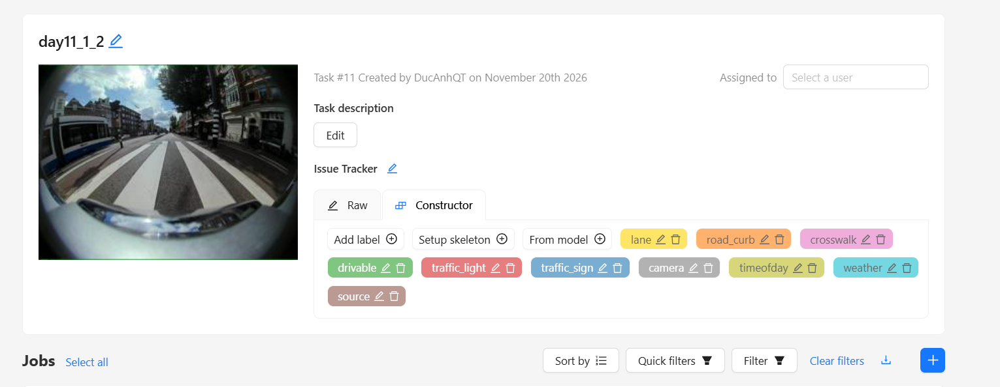
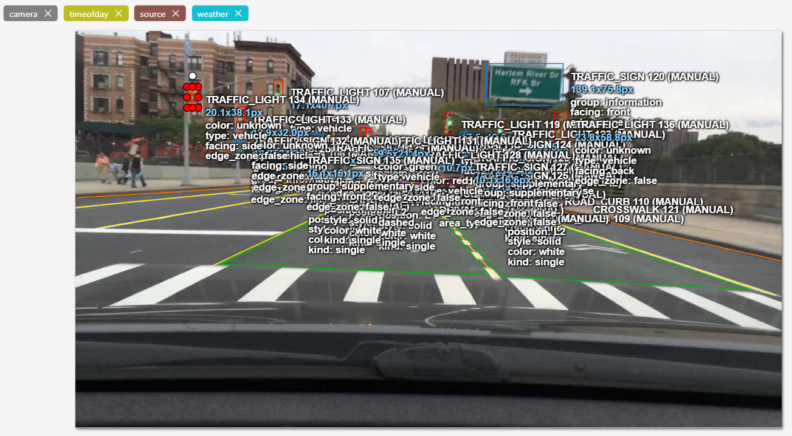
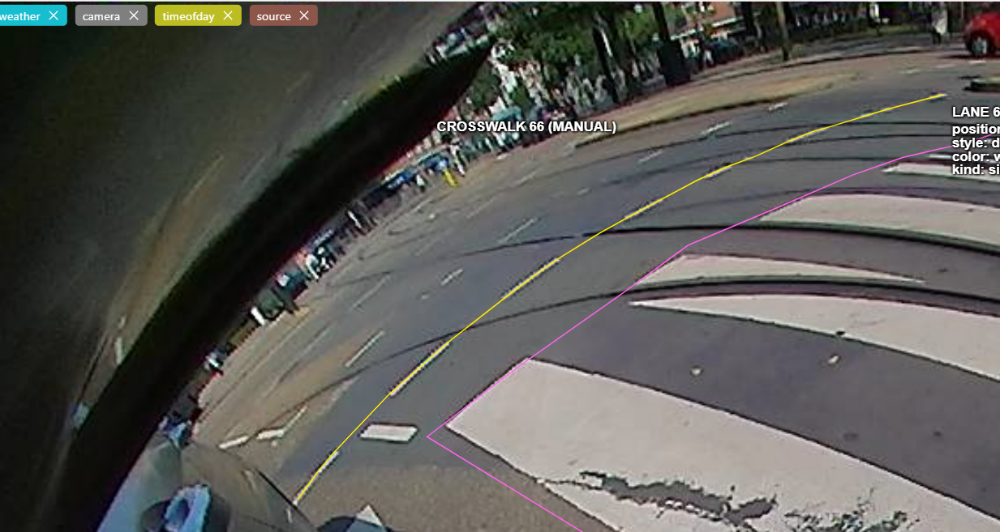

# Báo cáo cá nhân — Ngày 11

Họ tên: Nguyen Duc Anh  
Mã học viên: 03209  
Phiên bản CVAT (Help → About): v2.74.1
Guideline: Road v1.0  · Lần nộp (`revision`): 2  
Thời điểm export (CVAT): 1h30 ngày 21/12/2026  · Số lần nộp lại sau Rework: 1 (revision 2)

## 1. Kiểm project

| Mục | Đúng như guideline Road v1.0? | Ghi chú |
| --- | --- | --- |
| 6 label, đúng kiểu | Có theo metadata export | Parser đọc được cả hai export CVAT for images 1.1. |
| Thuộc tính và giá trị | Có cấu trúc hợp lệ; chưa đối chiếu từng hình với ảnh | Lint không báo label/giá trị lạ trong hai file. |
| 4 tag ảnh | Có | Front 12/12 và fisheye 8/8 đủ bốn tag; lint báo camera tag chưa khớp tên ảnh ở B02, B03, B04. Đã kiểm tra và xác nhận không cần thay đổi. |

Cách kết thúc polyline trên bản CVAT này: nhấn `N` theo hướng dẫn; cách thao tác chưa được ghi lại lúc làm.  
Cách đặt tag ảnh trên bản CVAT này: dùng label Tag, mỗi tag có thuộc tính `value`.

## 2. Số lượng đã gán

| Task | Ảnh | lane | road_curb | crosswalk | drivable | traffic_light | traffic_sign |
| --- | ---: | ---: | ---: | ---: | ---: | ---: | ---: |
| front | 12 | 33 | 14 | 8 | 25 | 26 | 35 |
| front-extra (đã làm 0 / 4) | 0 | 0 | 0 | 0 | 0 | 0 | 0 |
| fisheye | 8 | 8 | 6 | 11 | 8 | 4 | 6 |
| fisheye-extra (đã làm 0 / 4) | 0 | 0 | 0 | 0 | 0 | 0 | 0 |

## 3. Bảng ca khó

| Ảnh | Nhãn | Phân vân giữa | Đã chọn | Lý do |
| --- | --- | --- | --- | --- |
| A01_bc5fadac-fa6dd225.jpg, A04_b7a8e795-0ff55db2.jpg, A08_c0deebc1-16cfa791.jpg, A09_c7e6d5d1-c8af9fe3.jpg, A11_c1f35f18-b529c043.jpg | lane | Vạch đứt bị tách thành nhiều polyline hay là nhiều vạch riêng | Đã kiểm; không cần sửa | Người gán đã kiểm tra các cảnh báo và xác nhận giữ nguyên nhãn. |
| A10_b6ff1331-f6d3fba8.jpg | lane | Chiều vẽ gần ra xa | Đã kiểm; không cần sửa | Người gán đã kiểm tra cảnh báo và xác nhận giữ nguyên nhãn. |
| A05_b2576c8c-2de20b8a.jpg | lane | Không có vạch nhìn thấy được hay bị bỏ sót L1/R1 | Đã kiểm; không cần sửa | Người gán xác nhận không cần thay đổi; ghi nhận cảnh báo lint, không tính là lỗi xác nhận. |
| A06_b8c66e31-37045eec.jpg | lane | Không có vạch nhìn thấy được hay bị bỏ sót L1/R1 | Đã kiểm; không cần sửa | Người gán xác nhận không cần thay đổi; ghi nhận cảnh báo lint, không tính là lỗi xác nhận. |
| B02_03177_FV.png | camera, lane | camera=front hay fisheye_front; có vạch R1 không; chiều polyline | Đã kiểm; không cần sửa | Người gán đã rà soát cảnh báo và xác nhận giữ nguyên nhãn. |
| B03_04267_RV.png | camera | fisheye_front hay fisheye_rear | Đã kiểm; không cần sửa | Người gán đã rà soát cảnh báo và xác nhận giữ nguyên nhãn. |
| B04_05535_RV.png | camera | fisheye_front hay fisheye_rear | Đã kiểm; không cần sửa | Người gán đã rà soát cảnh báo và xác nhận giữ nguyên nhãn. |
| B05_05780_MVL.png | lane | position có phải `other`; vạch đứt có bị chia | Đã kiểm; không cần sửa | Người gán đã rà soát cảnh báo và xác nhận giữ nguyên nhãn. |
| B06_04068_MVL.png | lane | position có phải `other` | Đã kiểm; không cần sửa | Người gán đã rà soát cảnh báo và xác nhận giữ nguyên nhãn. |
| B07_01216_MVR.png | lane | position có phải `other` | Đã kiểm; không cần sửa | Người gán đã rà soát cảnh báo và xác nhận giữ nguyên nhãn. |
| B08_05783_MVR.png | lane | position có phải `other` | Đã kiểm; không cần sửa | Người gán đã rà soát cảnh báo và xác nhận giữ nguyên nhãn. |

## 4. Phiếu QC 1 nhận được

Bạn kiểm lô của tôi: Hoang Ba Dat (`hoangbadat`)  · Quyết định nhận được: chưa kết luận; phiếu đang chờ kiểm trực quan.

| Mã lỗi | Số cảnh báo lint | Đồng ý? | Đã sửa? |
| --- | ---: | --- | --- |
| QC1-02 | 3 | Chưa kết luận, cần xem ảnh A05/A06 |Đã sửa |
| QC1-11 | 1 | Chưa kết luận, cần xem biển ở B03 | Đã sửa |

Phiếu đã lập: [NguyenDucAnh-qc1-for-hoangbadat.md](NguyenDucAnh-qc1-for-hoangbadat.md). ZIP của Hoàng không đổi; đã chạy lại lint và vẫn có 4 cảnh báo. Không có ảnh nguồn/GT trong workspace; các gợi ý chưa được tính là lỗi xác nhận.

Lần cập nhật này được ghi là revision 2. Manifest revision 1 được lưu tại [r1/nguyenducanh-manifest-r1.json](r1/nguyenducanh-manifest-r1.json); ZIP cũ đã được thay trước khi có thể sao lưu vào `r1/`.

## 5. Kiểm file export

| File | Mở lại được? | Số shape ảnh 1 (job / file) | Số shape ảnh 2 (job / file) | Tag camera có trong XML? |
| --- | --- | ---: | ---: | --- |
| NguyenDucAnh-front.zip | Có, CVAT images 1.1 | 9 / 9 | 6 / 6 | Có (`front`) |
| NguyenDucAnh-fisheye.zip | Có, CVAT images 1.1 | 6 / 6 | 6 / 6 | Có; lint báo giá trị camera không khớp hậu tố ở B02, B03, B04 |

Đếm shape theo hai ảnh đầu trong thứ tự XML; đã đối chiếu số hình của từng label bằng `road_check lint`. ZIP không chứa ảnh. Có 20/20 ảnh đủ bốn tag. Lint revision 2 tổng kết 23 cảnh báo: 15 nặng, 8 chính, 0 nhẹ. Người gán đã rà soát các cảnh báo và xác nhận không cần thay đổi. Vì manifest lưu kết quả lint tại lúc tạo, các cảnh báo vẫn được giữ trong manifest và không được tính là lỗi đã xác nhận. Chi tiết hash, kích thước file và số hình nằm trong [manifest](nguyenducanh-manifest.json).

## 6. Ảnh chụp màn hình

1. Tab Labels của project (`label.png`):



2. Ảnh front đã gán lane, drivable, đèn và biển (`front.png`):



3. Ảnh fisheye có polyline cong (`polyline_fisheye.png`):



4. Đoạn XML lấy từ `annotations.xml` trong `NguyenDucAnh-front.zip`:
```xml
<polyline label="lane" source="manual" occluded="0" points="106.47,720.00;254.40,595.90;284.34,569.40;325.20,536.40;352.85,513.38;367.59,502.98" z_order="0">
  <attribute name="position">L1</attribute>
  <attribute name="style">dashed</attribute>
  <attribute name="color">white</attribute>
  <attribute name="kind">single</attribute>
</polyline>
```

## 7. Tự đánh giá

Lỗi bạn mắc nhiều nhất hôm nay (theo mã QC1-xx), và cách tránh ở Ngày 20: lint phát ra gợi ý về camera tag/position của lane fisheye và một số polyline. Sau khi tự rà soát, người gán xác nhận không cần chỉnh sửa; các gợi ý tự động vẫn được lưu để truy vết.

Nhãn của bạn đi vào model ở đâu? Label là tín hiệu giám sát trong dữ liệu huấn luyện. Ví dụ, nếu gán nhầm `position` hoặc thiếu một vạch nhìn thấy được, mô hình có thể học sai vị trí/ranh giới làn và dự đoán không ổn định cho tình huống tương tự.

## 8. (Tùy chọn, buffer) Từ polyline đến đích row-anchor

Chưa tính: cần chọn ảnh/polyline và hàng neo phù hợp. Không điền số ước lượng khi chưa chạy `rowanchor` trên ảnh được chọn.

